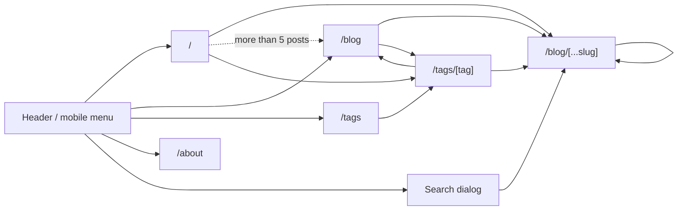

# Experience: everas.dev

## Foundation

A responsive web blog (Next.js 13 app router, content from MDX through Contentlayer). Readers
only: no accounts or sign-in. Visual identity is in [DESIGN.md](../../../DESIGN.md).

Captured at commit `7bfa77c` from the code, plus checks on a local production build (desktop
width, dark theme). Light theme and narrow widths are described from code only. Content at
capture: two posts, both `PostSimple`, no drafts.

## Information architecture

### Screens

| Route | Purpose | Source | Reached from |
| --- | --- | --- | --- |
| `/` | Greeting, site description, 5 newest posts, newsletter form | `app/page.tsx`, `app/Main.tsx` | Logo, mobile menu "Home", footer site name |
| `/blog` | All posts, page 1, with tag sidebar | `app/blog/page.tsx` | Header, sidebar "All Posts", home "All Posts" |
| `/blog/page/[page]` | Later pages, 5 per page | `app/blog/page/[page]/page.tsx` | Pagination (none at two posts) |
| `/blog/[...slug]` | One post; "Under Construction" if the slug is unknown or a draft | `app/blog/[...slug]/page.tsx` | Post rows, search, previous/next |
| `/tags` | All tags with post counts, most used first | `app/tags/page.tsx` | Header |
| `/tags/[tag]` | Posts with one tag, with tag sidebar | `app/tags/[tag]/page.tsx` | Any tag link |
| `/about` | Author photo, role, contacts, biography | `app/about/page.tsx`, `data/authors/default.mdx` | Header |
| `/projects` | Project cards (starter template content) | `app/projects/page.tsx` | No link; URL only |
| any other path | 404 with a link home | `app/not-found.tsx` | Bad links |

### Overlays

| Overlay | Purpose | Source | Opened by |
| --- | --- | --- | --- |
| Search dialog | Find a post by title or summary | Pliny KBar, `app/layout.tsx:80` | Header icon, `Cmd/Ctrl+K` |
| Mobile menu | Navigation below `sm` | `components/MobileNav.tsx` | Header menu button |

### Non-screen endpoints

| Path | Purpose | Source |
| --- | --- | --- |
| `/api/newsletter` | Subscribes an email through Mailchimp | `app/api/newsletter/route.ts` |
| `/feed.xml`, `/tags/<tag>/feed.xml` | RSS, generated after build; advertised in page metadata only | `scripts/rss.mjs` |
| `/search.json` | Search index, generated at content build | `contentlayer.config.ts:65-76` |
| `/sitemap.xml` | Header routes and posts | `app/sitemap.ts` |
| `/robots.txt` | Allows all crawlers | `app/robots.ts` |

Header links are Blog, Tags and About; Home is filtered out of the header and kept in the mobile
menu (`data/headerNavLinks.ts`, `components/Header.tsx:29-30`).

## Key flows

**Inferred from navigation. Not yet confirmed.** ★ marks where the reader gets what they came
for.

### F-1 Read a recent post from home
1. `/`: the reader sees the greeting and newest posts.
2. Selects a title or "Read more".
3. Post page: reads the article. ★
4. Moves to the previous or next post at the bottom, or uses the header.

### F-2 Browse all posts and narrow by tag
1. Header "Blog" → `/blog`.
2. Selects a post, or a tag in the sidebar or on a row → `/tags/[tag]`.
3. Selects a post. ★
4. Sidebar "All Posts" returns to `/blog`.

### F-3 Explore topics
1. Header "Tags" → `/tags`.
2. Selects a tag → `/tags/[tag]`.
3. Selects a post. ★

### F-4 Search for a post
1. From any page, the search icon or `Cmd/Ctrl+K`.
2. Types; results filter by title and summary.
3. Selects a result → post page. ★

### F-5 Learn about the author and get in touch
1. Header "About" → `/about`. ★
2. Follows email, GitHub, LinkedIn or the Toptal profile link. The footer icons offer the first
   three on every page.

### F-6 Subscribe to the newsletter
1. `/`: scrolls to the form under the post list.
2. Enters an email and selects "Sign up".
3. The button reads "Thank you!" and the field confirms the subscription. ★

## Component patterns

| Component | Behavior | Used on |
| --- | --- | --- |
| Header | Static, scrolls away. No current-page indication | All pages (`app/layout.tsx:81`) |
| Footer | Social icons render only when a URL is set | All pages |
| Link (`components/Link.tsx`) | Internal paths route in-app; `#` anchors stay; others open a new tab | Most links, and MDX links |
| Tag | Links to `/tags/<slug>` | Home, tag index, post lists, `PostLayout` |
| Post row | Title links to the post; home adds "Read more" | Home, blog, tag pages |
| Tag sidebar | Lists all tags with counts; the current one is not a link. From `sm` | Blog, tag pages |
| Pagination | Shown only when there is more than one page | Blog |
| Post navigation | Previous (older) and next (newer) post titles | Post page |
| Floating buttons | Scroll to top, from `md`, after 50px. The comment button needs comments configured | Post layouts |
| Search dialog | Loads the index on first mount; `Esc` closes; selecting navigates | All pages |
| Theme switch | Toggles stored theme between `dark` and `light`; default is `system` | Header |
| Mobile menu | Opening locks body scroll; closes on the close button or a link | Header |
| Newsletter form | Native email validation, then POST; locks after success | Home (also offered to MDX; no post uses it) |
| Code block | Copy button appears on mouse hover and shows a check for 2s | Posts |
| Card | Image, title and "Learn more" link to the same place | Projects |
| Comments | "Load Comments" button, only if a provider is configured. None is | Post layouts |

Post layouts, chosen by frontmatter `layout`:

| Layout | Shows | Posts using it |
| --- | --- | --- |
| `PostSimple` | Date, title, body, previous/next | Both |
| `PostLayout` (default) | Full date, title, authors, body, Twitter and GitHub links, tags, previous/next, back to blog | None |
| `PostBanner` | Banner image, title, body, previous/next | None |

## State patterns

Pages are generated at build time, so they have no loading state. There is no `loading.tsx` or
`error.tsx` in `app/`.

| Screen or component | Empty | Loading | Error | Other |
| --- | --- | --- | --- | --- |
| Home | "No posts found." | none | none | "All Posts" link only above 5 posts |
| Blog list | none | none | none | Out-of-range page shows the full list |
| Tag page | none (unknown tag: title and sidebar, blank list) | none | none | |
| Tag index | "No tags found." | none | none | |
| Post | n/a | none | none | Unknown or draft: "Under Construction 🚧", status 200 |
| About | none | none | none | |
| Projects | none | none | none | |
| Unknown route | n/a | n/a | 404 page, "Back to homepage" | |
| Search dialog | "No results for your search..." | "Loading..." | none (stays on "Loading...") | |
| Newsletter form | n/a | none | "Your e-mail address is invalid or you are already subscribed!" for any error response; none for a network failure | Success: "Thank you!", "You're subscribed ! 🎉" |
| Code copy | n/a | n/a | none | Success: check icon |
| Theme switch | n/a | Not rendered until mounted | n/a | |

Offline, permission-denied and first-run states: none.

## Voice and microcopy

First person and informal on home and About; short plain labels elsewhere. English only.

| Where | Text |
| --- | --- |
| Home heading | "Hi, I'm Enmanuel" |
| Site description | "Welcome to my blog - I am a software engineer with a passion for building great things. I love to read books and write my ideas." |
| Navigation | "Home", "Blog", "Tags", "About" |
| Lists | "All Posts", "Read more →", "Previous", "Next", "N of M" |
| Post | "Previous Article", "Next Article", "Back to the blog", "Discuss on Twitter", "View on GitHub" (`PostLayout` only) |
| Newsletter | "Subscribe to the newsletter", "Enter your email", "Sign up" |
| 404 | "Sorry we couldn't find this page." / "But dont worry, you can find plenty of other things on our homepage." / "Back to homepage" |
| Missing post | "Under Construction 🚧" |
| Tags metadata | "Things I blog about" |

## Accessibility floor

What the code provides today. Gaps are in [capture-notes](capture-notes.md).

- Page language `en-us` (`app/layout.tsx:62`).
- `header`, `main` and `footer` elements; posts and post rows use `article`.
- Screen-reader text for "Published on", social icons, the email field and the list search label.
- `aria-label` on search, theme, menu and floating buttons, "Read more" and previous/next links.
- Dates use `time` with `dateTime`.
- Search dialog closes with `Esc` and shows the hint.
- Newsletter field and button have focus rings. The search field removes its outline classes but
  showed a ring on the local build. The 404 button removes its outline. Other controls rely on
  browser focus styles.
- Smooth scrolling and menu animation apply regardless of reduced-motion settings.

## Responsive and platform

| From | Change |
| --- | --- |
| base | Site title hidden; header links replaced by the menu button; tag sidebar hidden; list pages show their `h1` |
| `sm` 640 | Site title and header links appear; menu button hidden; tag sidebar appears and list `h1` is hidden; newsletter form on one row |
| `md` 768 | Larger headings; cards two per row; floating buttons available |
| `xl` 1280 | Wider container; home and About switch to grid columns |
